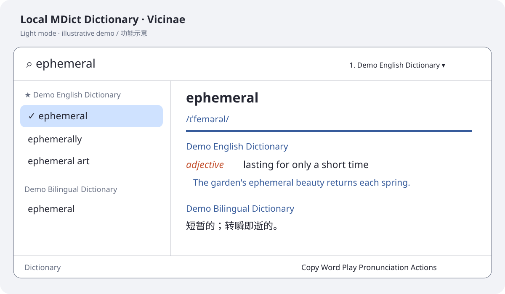
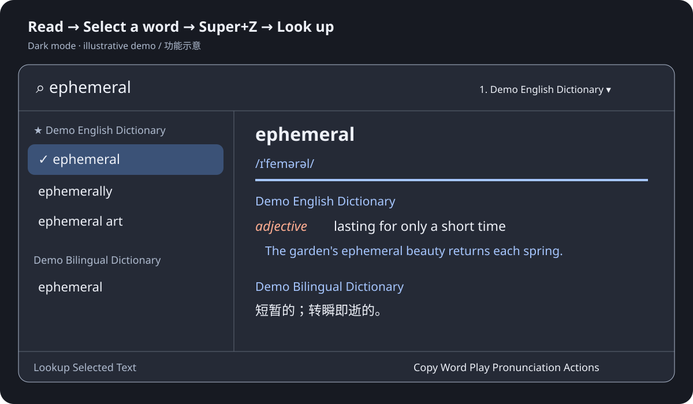

# Local MDict Dictionary for Vicinae

在 Vicinae 内实时查询本地 MDX/MDD 词典。React + TypeScript 原生列表，Python 隔离后端，多词典分组、浅色/深色适配、选中文字快速查词。




图片是依据实际扩展布局绘制的功能示意图，使用自行编写的释义，并非实时截图；真实排版取决于词典与 Vicinae 版本。不包含商业词典内容。

## 安装 / Quick start

本机基线：Linux / Zorin OS GNOME、Vicinae **v0.28.1**、SDK **0.22.3**（package-lock.json）。其他版本未逐一验证。需要已安装 Vicinae、Node.js 22+ 和 npm、Python 3.10+（含 venv / pip）。Ubuntu/Zorin 缺少 venv 时自行安装 `python3-venv`。

```bash
git clone https://github.com/Jingyuan-Zheng/vicinae-local-mdict.git
cd vicinae-local-mdict
./install-local.sh
```

脚本运行 `npm ci` 和官方 `vici build`，安装到 `${XDG_DATA_HOME:-$HOME/.local/share}/vicinae/extensions/local-mdict-dictionary`，在最终位置创建独立 `.venv` 并安装固定版本 Python 依赖。不要手动搬运 `.venv`，其中含绝对路径。支持 `PYTHON_BIN=/path/to/python3 ./install-local.sh`。

新增命令未出现时重启 Vicinae；`vicinae server --replace` 会结束当前会话并重新扫描。

默认词典目录是 **`~/Documents/Dictionaries`**，支持子目录。在 Settings → Local MDict Dictionary 修改 Dictionary Folder、Max Suggestions、Fuzzy Search。运行 **Configure Dictionaries**，从实际扫描到的文件选择启用、禁用、上移、下移及设为优先；无需手动填写词典名称。查询页下拉框可临时提升某本词典的优先级。

## 连续查词与 Super+Z

进入 Dictionary 一次，用 `Super+Space` 隐藏/恢复。关闭 Vicinae 的 **Pop to root on close** 可保留页面；返回首页或重启应用会结束会话。

选词查词可选安装 `xclip`（以及通常由 coreutils 提供的 `timeout`），在 GNOME Settings → Keyboard → Custom Shortcuts 新建：

```text
Name: Lookup Selected Text in Dictionary
Command: /home/YOUR_USER/.local/share/vicinae/extensions/local-mdict-dictionary/assets/lookup-selected-text.sh
Shortcut: Super+Z
```

替换用户名并检查快捷键冲突；使用 XDG_DATA_HOME 时调整路径。安装脚本不会修改桌面快捷键。如果桌面 PATH 找不到 Vicinae，用 `env VICINAE_BIN=/实际路径/vicinae /完整路径/lookup-selected-text.sh`。

脚本先在窗口获得焦点前读取 X11/XWayland PRIMARY 选区并传给 Dictionary，失败后回退官方 `getSelectedText()`，重试约 800 毫秒。不会模拟 Ctrl+C，也不读取普通剪贴板。原生 Wayland 支持取决于应用和合成器，获取不到会显示提示；API 入口拒绝超过 200 字符的选区。

## 实际支持范围

输入即时搜索：精确、前缀、大小写兼容、Unicode、基本模糊匹配。按词典分组，右侧显示启用词典中所选词的释义。Actions 提供 Copy Word、Copy Definition、Play Pronunciation、Open in GoldenDict-ng、Reload Dictionaries；音频可用 pw-play、paplay、mpv 或 ffplay 播放。

释义经 `List.Item.Detail` 的 rich-text 通道显示安全 HTML，传输属性仍名为 `markdown`。这不是完整浏览器 WebView：内联并适配 Qt Rich Text 支持的 HTML/CSS，**不保证完整网页 CSS/JavaScript 或像素级还原**。复杂布局、伪元素和动态交互有限制。禁用脚本、事件处理器、框架及远程资源。词条交叉引用通过 Actions → **Look Up Linked Word** 跳转，原文直接点击不是可靠支持功能。

索引、渲染缓存和按需提取的 MDD 资源会额外占用磁盘，位于官方 `environment.supportPath` 下的 `mdict-cache`；不复制整本词典。首次初始化较慢，后续复用缓存。文件变化在后续初始化检测，Reload Dictionaries 可手动重建；单本损坏词典隔离报错。清理缓存前先退出词典命令，下次会重新生成。

## 开发与目录

```bash
npm ci
npm run typecheck
npm run lint
npm run build       # 官方构建器会安装到本机扩展目录
./setup-helper.sh   # 可选：准备源码目录后端 venv
```

| 文件 | 用途 |
| --- | --- |
| `src/dictionary.tsx` | 查询 UI、Actions、后台通信 |
| `src/configure-dictionaries.tsx` | 文件扫描、启用和排序 |
| `src/lookup-selected-text.tsx` | 官方选区读取与重试 |
| `assets/backend/helper.py` | MDict 后端、缓存、资源和样式适配 |
| `assets/lookup-selected-text.sh` | 获得焦点前捕获选区 |
| `docs/images/` | README 演示图 |

## 开源与词典版权

代码采用 [MIT](LICENSE)。MDict 格式交给 [mdict-mquery 2.1.0](https://pypi.org/project/mdict-mquery/)，不自行重新实现。Beautiful Soup、Soup Sieve、RapidFuzz、Vicinae SDK 各自保留许可证。

词典、音频、字体、图片归各自权利人；请自行合法取得。仓库不下载或分发任何商业词典，不上传用户词典、缓存、虚拟环境、系统配置或凭据。

A native Vicinae `List + Detail` extension for local `.mdx` dictionaries and their `.mdd`, `.1.mdd`, `.2.mdd`, … resources.

## Install the helper

```bash
./setup-helper.sh
```

This creates an isolated `.venv` inside the extension. It never installs Python packages globally.

For a complete local build and install, run `./install-local.sh`. It installs Node dependencies with `npm ci`, uses the official `vici build`, and creates the isolated helper environment at its final installed location.

## Dictionaries

Put dictionaries in `~/Documents/Dictionaries` (subfolders are supported), or select another folder in Vicinae Settings. Matching MDD files must stay beside the MDX:

```text
Oxford.mdx
Oxford.mdd
Oxford.1.mdd
```

SQLite indexes and extracted on-demand resources are stored in Vicinae's per-extension support directory. Original dictionary files are read in place and are never copied into the extension.

## Backend

The helper uses `mdict-mquery` 2.1.0 (MIT), a Linux-compatible MDict reader with persistent SQLite indexes and block/result caches. Dictionary HTML and CSS are passed to Vicinae as sanitized inline rich HTML; scripts, event handlers, frames, remote URLs, and other active content are removed. Images, stylesheets, fonts, and pronunciation files are resolved from MDD files or from ordinary sidecar files beside the MDX. Dictionaries without an MDD continue to work normally.

Suggestions are split into one list section per dictionary. The first dictionary in `Dictionary Order` is the default priority; the dropdown in the search page can temporarily promote another dictionary to the top.

Run `Configure Dictionaries` to manage the MDX files discovered in the configured folder. It provides native enable/disable, move up, move down, and make-priority actions; no dictionary names need to be typed manually. Suggestions use lightweight persistent indexes. Definition rendering runs in cancellable workers and submits a complete document to avoid incremental scroll jumps; rendered results are cached on disk.
