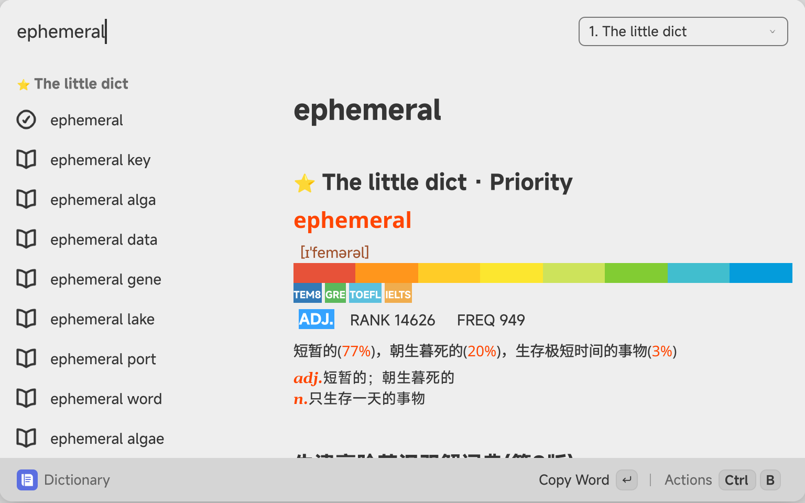
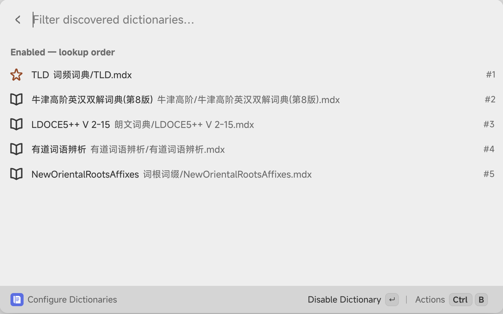

# Local MDict Dictionary for Vicinae

English | [简体中文](README.zh-CN.md)

Search local MDX/MDD dictionaries directly inside [Vicinae](https://vicinae.com). A native React + TypeScript list and detail view, backed by an isolated Python helper, with grouped suggestions, dictionary ordering, and selected-text lookup.

## Screenshots

Actual screenshots of the installed extension running on Linux/GNOME, cropped to the application window. Dictionary content belongs to its respective owners; dictionaries are not distributed with this project.

### Dictionary lookup



### Enable dictionaries and change their order



## Features

- Search as you type: exact matches, prefix suggestions, case handling, Unicode, and basic fuzzy matching.
- Suggestions grouped by dictionary, with definitions from enabled dictionaries in the detail pane.
- Enable, disable, reorder, and prioritize dictionaries using discovered files in **Configure Dictionaries**.
- Read MDX in place, with optional same-directory MDD archives, including numbered volumes. Dictionaries without MDD work too.
- Load images, stylesheets, fonts, and audio from MDD or local sidecar files.
- Light/dark adaptation, persistent indexes, rendered-result caches, and on-demand resources.
- Actions: Copy Word, Copy Definition, Play Pronunciation, Open in GoldenDict-ng, Reload Dictionaries, and Look Up Linked Word.
- Optional selected-text lookup with `Super+Z` on GNOME.

## Requirements

The working local baseline is **Vicinae v0.28.1 on Linux/GNOME**, using **@vicinae/api 0.22.3** as recorded in the lockfile. Other versions have not been individually verified.

- Vicinae installed and available on PATH.
- Node.js 22+ with npm.
- Python 3.10+ with pip and venv support (`python3-venv` on Ubuntu/Zorin if needed).
- Optional audio player: `pw-play`, `paplay`, `mpv`, or `ffplay`.
- Optional selected-text shortcut: `xclip` and `timeout`.

## Install

```bash
git clone https://github.com/Jingyuan-Zheng/vicinae-local-mdict.git
cd vicinae-local-mdict
./install-local.sh
```

The installer runs `npm ci` and the official `vici build`, then creates an isolated `.venv` at the installed extension location:

```text
${XDG_DATA_HOME:-$HOME/.local/share}/vicinae/extensions/local-mdict-dictionary
```

It does not install packages into system Python. Do not copy a virtual environment between locations: its scripts contain absolute paths. Select a Python interpreter with `PYTHON_BIN=/path/to/python3 ./install-local.sh` if necessary.

Restart Vicinae if new commands are not discovered. `vicinae server --replace` ends the current session and reloads extensions.

## Add dictionaries

The default folder is **`~/Documents/Dictionaries`**. Subfolders are supported. Keep matching MDX and MDD filenames together:

```text
~/Documents/Dictionaries/
├── Oxford/
│   ├── Oxford.mdx
│   ├── Oxford.mdd
│   └── Oxford.1.mdd
└── Other/
    └── My Dictionary.mdx
```

Change **Dictionary Folder**, **Max Suggestions**, and **Fuzzy Search** in Vicinae Settings → Local MDict Dictionary. Open **Configure Dictionaries** to enable and reorder actual discovered files. The search dropdown temporarily promotes another dictionary to priority.

## Continuous reading and selected-text lookup

Open Dictionary once, then use the normal `Super+Space` toggle to hide and restore it. Turn off Vicinae's **Pop to root on close** to preserve the page. Returning to the root or restarting ends the session.

For selected-text lookup, add a custom shortcut in GNOME Settings → Keyboard → Custom Shortcuts:

```text
Name: Lookup Selected Text in Dictionary
Command: /home/YOUR_USER/.local/share/vicinae/extensions/local-mdict-dictionary/assets/lookup-selected-text.sh
Shortcut: Super+Z
```

Replace `YOUR_USER`, adjust for XDG_DATA_HOME if set, and check for shortcut conflicts. Installation does not change your desktop shortcuts. If Vicinae is not on your desktop session's PATH, use `env VICINAE_BIN=/path/to/vicinae /absolute/path/lookup-selected-text.sh`.

The script reads X11/XWayland PRIMARY before the launcher takes focus, then opens Dictionary with that query. Otherwise it falls back to the official `getSelectedText()` API with retries for about 800 ms. It does not simulate Ctrl+C or read the ordinary clipboard. Native Wayland support depends on the application and compositor. Missing selections produce a message; the API entry rejects selections longer than 200 characters.

## Rendering and storage

Definitions use sanitized HTML through `List.Item.Detail`'s rich-text transport, whose property is named `markdown`. This is **Qt Rich Text, not a full browser WebView**. Styles are inlined and adapted to supported HTML/CSS; complex layout, pseudo-elements, dynamic interaction, and pixel-perfect reproduction are not guaranteed. Scripts, event handlers, frames, and remote resources are removed. Use **Actions → Look Up Linked Word** for cross-references; direct clicking inside definitions is not reliably supported.

Indexes, rendered results, and extracted resources take additional disk space under `environment.supportPath/mdict-cache`. Original MDX/MDD files are not copied. First initialization may take longer; later queries reuse indexes and caches. File signatures are checked at initialization; **Reload Dictionaries** rebuilds manually. Damaged dictionaries are isolated. Exit the dictionary command before clearing its cache; the next lookup regenerates it.

## Development

```bash
npm ci
npm run typecheck
npm run lint
npm run build       # Installs into the local Vicinae extension directory
./setup-helper.sh   # Optional source-directory backend environment
```

| File | Purpose |
| --- | --- |
| `src/dictionary.tsx` | Query view, actions, backend communication |
| `src/configure-dictionaries.tsx` | File discovery, enablement, ordering |
| `src/lookup-selected-text.tsx` | Selection API and retries |
| `assets/backend/helper.py` | MDict backend, caching, resources, HTML/CSS adaptation |
| `assets/lookup-selected-text.sh` | Pre-focus selection capture |
| `docs/images/` | Actual application screenshots |

## License

Extension code: [MIT](LICENSE). MDict parsing is handled by [mdict-mquery 2.1.0](https://pypi.org/project/mdict-mquery/), not reimplemented here. Dependencies retain their respective licenses.

Obtain dictionaries legally. Dictionary text, fonts, images, and recordings belong to their respective rights holders. No dictionary files, user caches, environments, credentials, or system configuration are included in the repository. Screenshots show the application using locally installed dictionaries and do not grant redistribution rights to those dictionaries.
